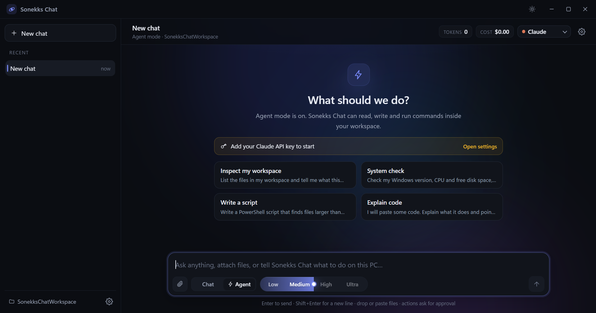

# Sonekks Chat

A clean, fast desktop AI chat and agent for Windows. Bring your own API key, talk to the model, or let it work on your machine inside a folder you choose.



## Why it exists

Most desktop AI apps are either a chat box with no hands, or an agent that quietly runs shell commands. Sonekks Chat keeps both: toggle **Chat** for a normal conversation, toggle **Agent** and it can read, write and run PowerShell, but every write or command waits for an explicit **Allow**.

## Features

**Chat and agent in one window**
Six tools: `run_command` (PowerShell), `read_file`, `write_file`, `edit_file`, `list_dir`, `search_files`. Read only tools run immediately, writes and commands always ask first. Everything is sandboxed to your chosen workspace folder.

**Attachments**
Drop files, paste images or use the paperclip. Images are sent natively to models that support vision, text and code files are inlined. Attachments are stored locally and stay in context for later turns.

**Effort slider**
Low, Medium, High and Ultra. It maps to each provider's real control: Anthropic `output_config.effort`, Gemini `thinkingConfig.thinkingLevel`, OpenAI compatible `reasoning_effort`, plus output token budgets.

**Token and cost meters**
Live token count and spend for the conversation, per step token and cost breakdown under every reply, and the model name that actually served it.

**Token saver**
One switch: keeps the last four turns of context, caps replies near 2k tokens, trims tool output and asks for terser answers. On long agent runs this is where most of the bill lives.

**Free mode**
Uses only zero cost models: OpenRouter `:free` models and Gemini free tier models. When one hits a rate or credit limit it automatically moves to the next free model and tells you which one it switched to.

**Four providers**
Anthropic, DeepSeek, Google and OpenRouter. Model lists are read live from each provider, so new IDs appear without updating the app. Keys are masked after saving and can be verified per provider, including a vision probe that proves a DeepSeek endpoint is really serving the Flash family.

## Install

Download `sonekks-chat-0.1.0-setup.exe` from [Releases](https://github.com/sonekkdev/sonekks-chat/releases) and run it. The installer is unsigned, so Windows SmartScreen will ask for confirmation.

First start: open Settings, paste a key, press Save, then Verify. Choose a workspace folder before using Agent mode.

## Build from source

Requirements: Node.js 20 or newer on Windows.

```powershell
npm install
npm run dev
```

Package a Windows installer:

```powershell
npm run dist
```

## Privacy and security

- API keys are encrypted with Windows DPAPI through Electron `safeStorage` and stored in `%APPDATA%\Sonekk\settings.json`
- No key or token is ever written into the source code or the packaged app
- Nothing is sent anywhere except the provider you selected
- No telemetry, no analytics, no accounts, no backend
- Agent tools are confined to the workspace folder; escaping paths are rejected
- Every write and command requires approval unless you deliberately disable it

## Built with

Electron 33, React 19, TypeScript, Vite. Developed and tested against DeepSeek 4.1 Flash 1017, with first class support for Claude Fable, Opus and Sonnet 5.5, Gemini 4 Argon and 3.8 Flash, and any OpenAI compatible endpoint.

## License

**Source available, not open source.** Licensed under the [PolyForm Noncommercial License 1.0.0](LICENSE).

You may read it, learn from it, modify it and share it for any noncommercial purpose: personal use, study, hobby projects, research, and use by schools, charities and public institutions.

You may not sell it, bundle it into a paid product, or use it commercially.

If you redistribute it, modified or not, you must pass on the required notice that credits Sonekks Chat and sonekkdev. That is not a courtesy request, it is part of the license terms, so the credit must travel with every copy and every fork. See [NOTICE](NOTICE).

This applies to version 0.2.0 and later. Version 0.1.0 was published under the MIT license and stays under it, because that permission cannot be revoked.

Required Notice: Copyright 2026 sonekkdev (https://github.com/sonekkdev/sonekks-chat)

